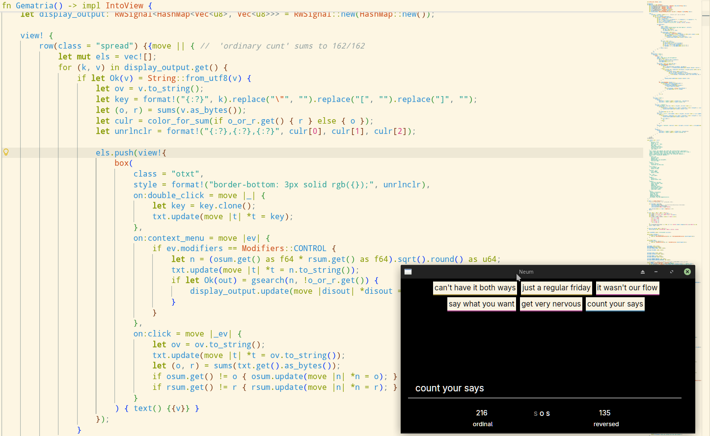

ordinal and reversed gematria, in a stateful redb app that uses zgui for a basic interface

pressing enter saves things and does gsearch or search depening on the the middle three letters 

``(s [o/r] s)`` which stands for Search, Orinal/Reversed and Saturate (save)

double clicking entries puts their key in the bar, pressing delete on the bar deletes that one

lists and notes still need ui, but you can divinate with this so long #ccru

the middle letter cycles ``o → r → b``, b being the byte sum bucket, Σ(byte+1), for anything at all; in b the byte sum story of the bar shows under the sums, and ``104,105`` reads as those bytes

middle click the bar to make its text the alt name (right click shows it): with s on enter lists things in it, with s off enter notes it on things, an empty bar shows them, delete on a key takes one back off

escape: what's in the open memory, open another by path or close it like game saves, backup/restore/repair, light mode, compact on open; settings keep in ~/.config/neum/settings.json (or NEUM_CONFIG)
