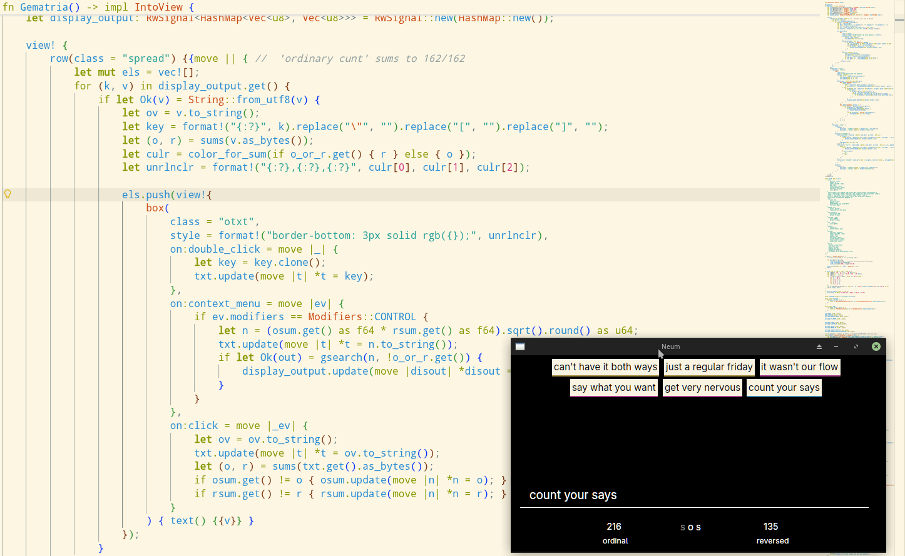

# neum



ordinal, reversed and byte-sum gematria, in a stateful [redb](https://github.com/cberner/redb) app
that uses [zgui](https://github.com/zortax/zgui) for its interface. Everything typed can be
saturated (saved) into a memory, found again by any of its sums or its words, gathered into lists
and hung with notes. You can divinate with this so long #ccru

## build and run

```console
cargo run --release               # opens the last memory, or ./memory
cargo run --release -- my.memory  # opens (or makes) my.memory
```

Linux needs the usual windowing headers to build: `libxkbcommon-dev` and `libwayland-dev`
(and `pkg-config`). Rust 1.90 or newer.

## the bar

Type into the bar and its sums show underneath. The three letters between them are toggles:

``s [o/r/b] s`` — **S**earch, which sum (**O**rdinal / **R**eversed / **B**ytes), **S**aturate.

| letter | on | off |
|---|---|---|
| first `s` | the **search channel**: Enter looks memories up by their words | the **gematria channel**: Enter looks memories up by the sum |
| middle | click to cycle `o → r → b → o` | hidden while searching by words |
| last `s` | Enter also saves what was typed (once) | Enter only looks |

**o** is a=1 … z=26, **r** is a=26 … z=1, and **b** is the byte sum bucket: every byte counts
`byte + 1`, so it sums anything, letters or not, text or raw bytes. With **b** on, the byte sum
story of the input shows above the sums: its length, mean, digit sum and roots, the byte sum's
prime factors, and its prime-factor reduction chain. Input written as bytes (`104,105`, the
way keys are shown) is read as those bytes, so `hi` and `104,105` tell the same story.

On the gematria channel a number is a sum to look up (ctrl+Enter sums it as text instead).

### lists and notes

Middle click the bar to move its text into the **alt name** (right click the bar to see it). The
alt name is a memory too, and what Enter and Delete do with it depends on the channel:

| | search channel (`s` on) | gematria channel (`s` off) |
|---|---|---|
| Enter with text | adds what was found to the alt name's **list** | makes it a **note** on the alt name |
| Enter on an empty bar | shows the list | shows the notes |
| Delete on a key | takes it off the list | unlinks the note |

Without an alt name, Delete on a key forgets that memory (and puts its text back in the bar).

### the entries

Click an entry to put its text in the bar; double click to put its key there (keys are bytes,
like `0,1`). Ctrl + right click looks up the mean of the two sums shown. Each entry is underlined
in a colour from one of its other sums, so entries that agree on that sum share a colour.

## the escape menu

Esc opens it (Esc again, or a click outside, closes it).

- **memory** — the open memory's file, size on disk, how many memories, lists and notes it holds,
  the last id handed out and how many freed ids wait to be reused. *repair* rebuilds every index
  and drops links that point at nothing.
- **saves** — memories are files, kept like game saves. Type a path and *open* it (a new path makes
  a new memory), *close* the open one, *export* it to JSON (to a typed `.json` path, or next to the
  memory with the time in its name) or *import* a JSON export into an empty memory. The memories
  opened before are listed; click one to open it, × to take it off the list.
- **settings** — light or dark mode, whether saturate starts on, whether a memory is compacted when
  opened, and how many of a query's words a search match must share (50 / 75 / 90 / 100%).
- **keys** — the controls above, in short.

Settings live in `neum/settings.json` under your config folder (`$XDG_CONFIG_HOME`, `~/.config`
or `%APPDATA%`), or wherever `NEUM_CONFIG` points.

## which memory opens

The first argument, else `$NEUM_MEMORY`, else the last memory open, else `./memory`. A memory
that can't be opened (already open in another neum, say) leaves the window up, and the escape
menu can open another.

Memories made by 0.1 open as they are; their byte sum bucket is built the first time they open.

## as a library

The window is `src/main.rs`; everything under it is the `neum` library, usable on its own:

```rust
use neum::{Memory, Mode, gematria::sums};

let m = Memory::open("my.memory", false)?;
let id = m.saturate(b"ordinary cunt", None)?;
assert_eq!(sums(b"ordinary cunt"), (162, 162));
assert!(m.gsearch(162, Mode::Ordinal)?.contains_key(&id));
```

`cargo run --example inspect -- my.memory 162` prints a memory's details and what sits at a sum.

## development

```console
cargo test            # sums, fast paths against scalar, the memory end to end, settings
cargo clippy --all-targets
```

See [CONTRIBUTING.md](CONTRIBUTING.md) and [CHANGELOG.md](CHANGELOG.md).

## license

MIT, see [LICENSE](LICENSE).
